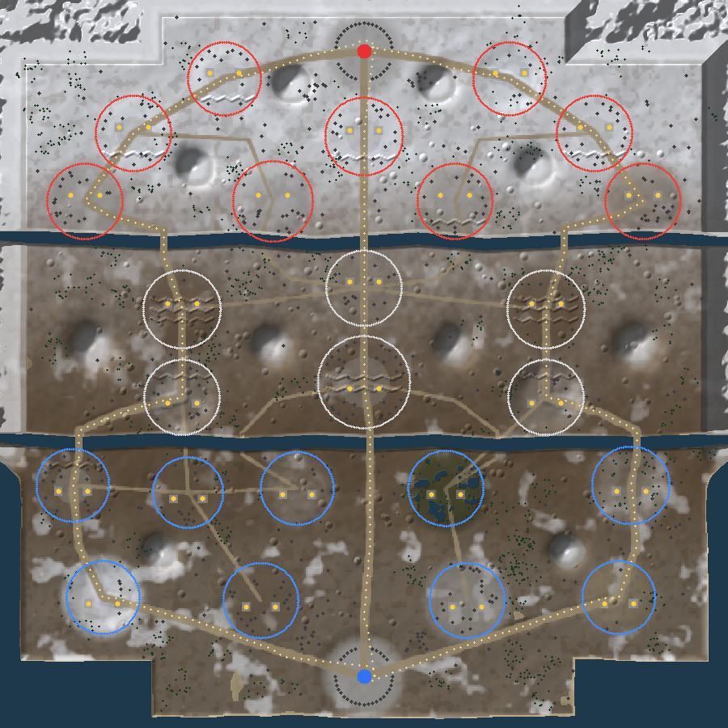

# 전장 맵: 얼어붙은 전선 (Frozen Front)

사용자가 제작한 전장 컨셉 지도(`Docs/reference/battlefield_map_concept.png`)의 배치를 그대로 따라
1200m × 1200m 월드 좌표로 옮겼다. 레이아웃 데이터: `Assets/RoadToValor/Resources/RoadToValor/Data/map_layout.json`.

`map_preview_generated.png`는 실제 게임과 같은 코드(MapGenerator)로 만든 지형·구역·공격로·건설 패드(노란 점)·오브젝트 배치를
위에서 내려다본 이미지다 (`dotnet run --project Tools/CoreTests -c Release -- preview out.ppm`).

## 좌표계
- x: 동(+) / 서(-), z: 북(+) / 남(-), 맵 범위 -600 ~ +600
- 적군 본진 (0, 515) · 아군 본진 (0, -515)
- 강 2개 (z ≈ +200, z ≈ -130): 공격로 교량 6개 + 정글 얕은 여울 4개
- 북쪽·북측면: 설산 (통행 불가) / 남쪽 모서리: 바다

## 24개 점령 구역과 원본 지도 번호 대응

원본 지도 이미지에는 구역이 23개 그려져 있고 번호가 `2~24`이며 `8`이 두 번, `1`과 `17`이 없다.
24개 구역 규칙을 맞추기 위해 아래처럼 정리했다. 위치와 이름은 원본 그대로이며, 17번 하나만 새로 추가했다.

| 게임 # | 이름 | 원본 지도 표기 | 초기 소유 | 지형 테마 |
|---|---|---|---|---|
| 1 | 북부 전진기지 | 2 | 적군 | 설원 요새 |
| 2 | 북동 산악 | 3 | 적군 | 설산 |
| 3 | 서부 요새 | 4 | 적군 | 설원 요새 |
| 4 | 북부 중앙 진지 | 5 | 적군 | 설원 요새 |
| 5 | 동부 요새 | 6 | 적군 | 설원 요새 |
| 6 | 서부 산업지대 | 7 | 적군 | 공장지대 |
| 7 | 폐허 도시 | 8 | 적군 | 폐허 시가지 |
| 8 | 북동 요새 | 8 (두 번째, "몽부 오새") | 적군 | 요새 |
| 9 | 동부 전차 묘지 | 9 | 적군 | 전차 잔해 |
| 10 | 서부 참호 | 10 | 중립 | 참호 |
| 11 | 중앙 철도 거점 | 11 | 중립 | 철도 기지 |
| 12 | 동부 참호 | 12 | 중립 | 참호 |
| 13 | 서쪽 고지대 | 13 | 중립 | 고지대 |
| 14 | 중앙 전략 거점 | 14 | 중립 | 중앙 대규모 거점 (점령 시 CP 충전 +15%) |
| 15 | 동쪽 고지대 | 15 | 중립 | 고지대 |
| 16 | 서부 장벽 | 16 ("서부 장변") | 아군 | 방벽 |
| 17 | 남서 전초기지 | **(없음 — 추가)** | 아군 | 전초기지 |
| 18 | 남부 평원 | 18 | 아군 | 평원 |
| 19 | 남동 늪지 | 19 ("남동 늪재") | 아군 | 늪지대 |
| 20 | 동부 숲 | 20 | 아군 | 숲 |
| 21 | 남서 산악 | 21 | 아군 | 설산 |
| 22 | 남부 보급로 | 22 | 아군 | 전방 보급 기지 |
| 23 | 남동 산업지대 | 23 | 아군 | 공장지대 |
| 24 | 남동 해안 | 24 | 아군 | 해안 |

양 진영 각 9구역, 중립 6구역. 구역마다 건설 패드가 정확히 2개(총 48개)다.
번호나 위치를 바꾸고 싶으면 `map_layout.json`의 `zones` 배열만 수정하면 된다 (패드 위치는 `pads`로 개별 지정 가능).

## 공격로
| 공격로 | 경유 구역 (아군 → 적군) |
|---|---|
| 탑 (서쪽) | 21 → 16 → 13 → 10 → 6 → 3 → 1 |
| 미드 (중앙) | 14 → 11 → 4 |
| 바텀 (동쪽) | 24 → 20 → 15 → 12 → 9 → 5 → 2 |

정글 우회로 구역: 17, 18, 19, 22, 23, 7, 8 (오솔길과 여울로 연결).

## 직접 만든 3D 지형 사용하기
씬에 이름이 `BattlefieldTerrain`인 Terrain이 있으면 생성 지형 대신 그 지형을 사용한다.
단, 현재 버전에서는 유닛의 높이·길찾기·점령 판정이 여전히 생성된 높이맵과 `map_layout.json`을 기준으로 계산된다.
직접 만든 지형의 높이를 내비게이션 그리드로 변환하는 기능은 **아직 구현되지 않았다** (다음 단계 과제).
