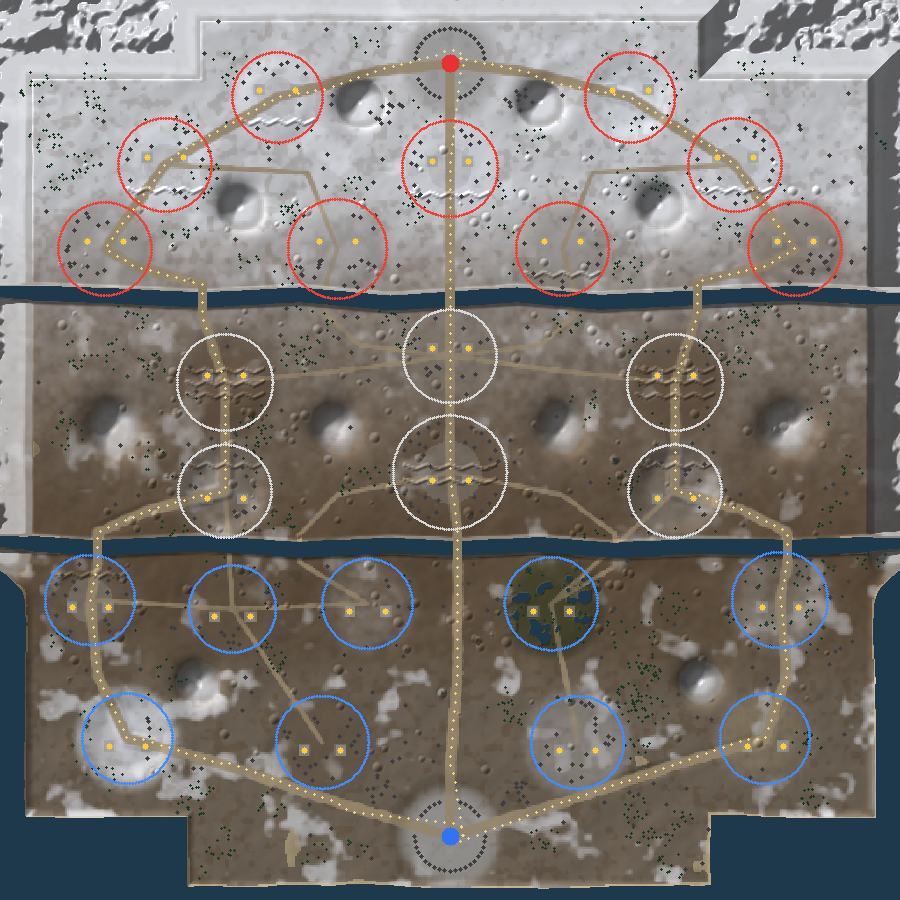

# ROAD TO VALOR: HONOR COMMAND (로두터발러)

1200m × 1200m 전장에서 24개 구역을 놓고 싸우는 **3D 탑다운 쿼터뷰 실시간 전략(RTS) 전쟁 게임** — Unity 6 + C# + URP.
탑·미드·바텀 3개 공격로와 정글 우회로, 74종 유닛 카드, CP 지휘 에너지, 건설 패드 48개, 잔해 철거, AI 적군 사령관을 갖춘 1인용 AI 대전 프로토타입이다.

> 캐릭터·UI·맵은 모두 독창적인 밀리터리 디자인이며, 전장 배치는 사용자가 만든 컨셉 지도(`Docs/reference/battlefield_map_concept.png`)를 따른다.



---

## 1. 실행 방법

### 권장: Unity 6 URP 템플릿 프로젝트에 넣기
1. Unity Hub → **New project** → Unity 6 (6000.0 LTS) → **Universal 3D** 템플릿으로 새 프로젝트 생성
2. 이 저장소의 `Assets/RoadToValor` 폴더를 새 프로젝트의 `Assets/` 아래로 복사
3. 아무 씬(기본 `SampleScene`도 가능)을 열고 **Play**

씬 설정이 필요 없다. `GameBootstrap`이 Play 시 자동으로 게임을 시작한다
(특정 씬에서 자동 시작을 막으려면 그 씬에 `RTV_NoAutoBoot`라는 빈 GameObject를 둔다).

### 또는: 이 저장소 폴더를 바로 열기
`Packages/manifest.json`(URP·Input System 포함)과 `ProjectSettings/ProjectVersion.txt`(6000.0.23f1)가 들어 있다.
Unity Hub에서 폴더를 추가해 열면 된다. 이 경우 URP 파이프라인 에셋이 지정되지 않아 **Built-in 렌더러로 대체 렌더링**된다
(코드가 자동 감지하므로 분홍색 재질은 나오지 않는다). URP로 보려면 URP 에셋을 만들어 *Project Settings → Graphics*에 지정하면 된다.

### 입력 시스템
새 Input System(Unity 6 템플릿 기본값)과 구 Input Manager 둘 다 지원한다 (`#if ENABLE_INPUT_SYSTEM`).

### 한글 폰트
UI는 OS 한글 폰트(맑은 고딕 / Apple SD Gothic Neo / Noto Sans CJK KR)를 자동으로 사용한다.
특정 폰트를 쓰려면 `Assets/RoadToValor/Resources/RoadToValor/Fonts/UIFont.ttf`로 넣는다.

---

## 2. 조작법

| 입력 | 동작 |
|---|---|
| WASD / 방향키 / 화면 가장자리 | 카메라 이동 (Shift: 빠르게) |
| 마우스 휠 | 확대·축소 (줌에 따라 각도 변화) |
| Space | 선택 부대 위치로 카메라 이동 |
| 미니맵 좌클릭(드래그) | 카메라 이동 · 미니맵 우클릭: 선택 부대 이동 |
| 좌클릭 / 드래그 | 유닛 선택 / 다수 선택 (Shift 추가, 더블클릭 같은 종류 전체) |
| 우클릭 지면 / 적 | 이동 / 공격 (공병 선택 후 잔해 우클릭: 철거) |
| A + 클릭 | 공격 이동 |
| S / H | 정지 / 위치 사수 |
| F | 선택 유닛 특수 능력 (돌격, 병력 하차, 자폭 등) |
| Ctrl + 숫자 / 숫자 | 부대 지정 / 선택 (두 번 누르면 카메라 이동) |
| F1~F8 또는 카드 클릭 | 카드 배치 모드 → 좌클릭 배치, 우클릭/ESC 취소, Shift 연속 배치 |
| ESC | 일시 정지 메뉴 (설정, 게임 속도, 항복) |

> WASD 카메라와 A/S 명령이 겹치는 문제는, 부대가 선택된 상태에서 A/S를 **짧게 누르면 명령**, **길게 누르면 카메라 이동**으로 처리했다.

---

## 3. 구현된 게임 규칙

- **전장**: 1200m × 1200m, 북쪽 적군 본진 / 남쪽 아군 본진, 탑·미드·바텀 공격로, 정글 오솔길, 강 2개(교량 6, 여울 4), 설산, 진흙 평야, 늪지, 해안, 참호, 벙커 잔해, 파괴된 전차·트럭, 숲, 공장, 철도 거점, 전방 보급 기지 (오브젝트 약 2,300개)
- **24개 점령 구역**: 중립 회색 / 아군 파랑 / 적군 빨강, 점령 게이지 표시, 양 진영이 함께 있으면 **경합 중(진행 정지)**. 상대 구역은 먼저 중립화한 뒤 점령한다. 인원이 많을수록 빨리 점령된다 (최대 2.5배).
- **건설 패드 48개**: 구역당 정확히 2개, **점령한 진영만** 건설 가능, **3번째 건설은 차단**. 건물이 파괴되면 **잔해**가 남고 **공병(8 공병 소대, 73 전투 공병 장갑차)이 철거해야** 재건설할 수 있다.
- **CP**: 최대 10, 시간에 따라 충전(설정값 0.35/초), 카드 비용 차감, 부족하면 사용 불가, **자원 채굴기 건설 시 1.5배**, **보급 투하 +3**, 모든 변화는 0~10으로 제한. 중앙 전략 거점(14) 점령 시 +15% (제안값).
- **공격로 증원**: 32초마다 양측 본진에서 3개 공격로로 보병 부대가 진격, 경로상의 구역을 점령하며 적 본진까지 공격한다.
- **자동 전투 AI**: 적 탐색(공간 분할), 사거리 판단, A* 경로 탐색과 장애물 우회, 교전·추격 제한, 건물·본진 공격, 구역 진입·점령, 역할별 행동(치료, 수리, 지뢰, 포격 요청, 은신, 자폭 등). **플레이어의 이동·공격 명령이 자동 AI보다 우선**한다.
- **적군 사령관 AI**: 같은 CP·덱·배치 규칙으로 본진 방어, 공격로 선택, 최전방 구역에 병력 배치, 빈 패드 건설, 공병으로 잔해 철거, 밀집한 적에게 폭격 스킬 사용 (쉬움/보통/어려움).
- **승리 조건**: 적군 본진 파괴.
- **로비**: 중앙 3D 전장 미리보기(배경에서 AI 대 AI 전투가 실제로 진행), 전투 시작·난이도, 부대 편성(74장 중 8장), 유닛 도감(회전 3D 미리보기), 연구소, 군수 보급, 전적 기록, 상점, 레벨·골드·보석.
- **HUD**: 상단 양측 본진 체력·경기 시간·구역 수·격파 통계 / 하단 선택 유닛 정보(초상화, 체력, 능력 버튼)·카드 8장·CP 게이지 / 우측 하단 대형 미니맵(구역, 유닛, 공격로, 카메라 시야) / 전장 위 점령 게이지·체력 바·선택 원·건설 패드·이동/공격 표시.

---

## 4. 74종 유닛

- 이름·분류: 로스터 이미지(`Docs/reference/unit_roster_74.png`)에서 등록 → `unit_roster.csv`
- **원본 기획서의 수치(희귀도, 체력, 공격력, 비용, 소환 수, 특수 능력)가 이 저장소에 없어서** 임의로 확정하지 않고 `unit_balance.csv`에 **초기 제안값**으로 작성했다. 원본 수치로 CSV를 덮어쓰면 코드 수정 없이 그대로 반영된다.
- 희귀도는 이미지 배지 색으로 **임시 추정**했다.
- 전체 표: [`Docs/UNITS.md`](Docs/UNITS.md)

특수 능력 30종이 데이터로 연결되어 있다: 돌격, 치료, 수리·잔해 철거, 지뢰 탐지·해체, 지뢰 매설, 방패, 제압 사격, 지휘 오라, 정찰·은신 탐지, 은신, 병력 수송, 공수 강하, 자폭, 심리전, 드론 발진, 포격 요청, 화염 지속 피해, 보급 지원, 정밀 폭격, 융단 폭격, 보급 투하(+3 CP), 화물 수송선(CP 충전 가속), V2 미사일, 연쇄 전격, 감속 지대, 엄폐 강화, 전방 배치 거점, CP 1.5배, 조명탄. 곡사포·박격포류는 **아군이 관측한 적에게만** 사격한다 (정찰병·드론·레이더의 의미).

---

## 5. 구조

```
Assets/RoadToValor/
  Resources/RoadToValor/Data/      ← 모든 수치·규칙·맵 (CSV/JSON, 코드 수정 없이 밸런싱)
    unit_roster.csv  unit_balance.csv  game_config.json  map_layout.json
  Scripts/Core/    (엔진 독립 C# — UnityEngine 참조 없음)
    Data/   CSV·JSON 로더, UnitDefinition, GameConfig, MapLayout
    Map/    MapGenerator(지형·강·참호·소품·공격로), NavGrid, Pathfinder(A*)
    Sim/    BattleSimulation(20Hz 고정 틱), SimUnit, 전투·능력·배치·점령·CP·증원, SpatialHash
    AI/     EnemyCommander (카드 사용 AI)
  Scripts/Game/    (Unity 표현 계층)
    GameBootstrap / GameRoot      자동 시작, 로딩, 로비↔전투 전환, 조명·안개
    World/      Unity Terrain(8개 절차적 텍스처 레이어), 물, 소품 청크 결합, 교량, 구역 경계·깃발, 건설 패드
    Units/      UnitModelFactory(플레이스홀더 모델), UnitView(보간·지형 추종·LOD), 애니메이션 상태 머신, 오브젝트 풀
    Control/    RtsCamera, CommandController(선택·명령·부대 지정·카드 배치)
    Fx/         풀링된 이펙트(예광탄, 포탄, 폭발, 연기, 화염, 전격, 공습 비행, 경고 표시, 눈)
    UI/         BattleHud, LobbyUI, UiTheme, PortraitRenderer(3D 모델로 카드 초상화 생성)
    Meta/       PlayerProfile (레벨·재화·덱·연구·전적 저장)
Tools/CoreTests/          dotnet 헤드리스 테스트 (시뮬레이션 + 맵)
Tools/UnityCompileCheck/  UnityEngine.dll 참조로 Unity 계층 컴파일 검사
Docs/                     MAP.md, UNITS.md, ASSETS.md, 참조 이미지
```

- **데이터와 전투 로직 분리**: 모든 유닛은 고유 ID(1~74, 본진 900)로 CSV에 정의되고 시뮬레이션이 그 값을 그대로 사용한다.
- **멀티플레이 확장 대비**: 모든 입력이 직렬화 가능한 `GameCommand`로 시뮬레이션에 들어가고, 시뮬레이션은 고정 틱·결정적 난수를 쓰는 엔진 독립 코드라 락스텝 동기화나 전용 서버로 옮기기 쉽다.
- **최적화**: 오브젝트 풀링(유닛 뷰·예광탄·포탄·지뢰), 원거리 LOD(그림자 끄기, 애니메이션 3프레임마다), 화면 밖 애니메이션 생략, 공간 분할 적 탐색, 틱당 A* 연산 예산(경로 재계산 빈도 제한), 이펙트 상한, 공유 팔레트 재질 1개, 소품 64개 청크 메시 결합.

---

## 6. 테스트 결과 (이 저장소에서 실제로 실행한 것)

| 검증 | 방법 | 결과 |
|---|---|---|
| 시뮬레이션·맵 로직 | `dotnet run -c Release --project Tools/CoreTests` (.NET 8, C# 9, netstandard2.1로 Core 컴파일) | **76개 검사 모두 통과** |
| 첫 목표 시나리오 | 보병 4명 선택 → 490m 이동(약 52초) → 14번 구역 점령(9초) → 적 출현 시 자동 교전·경합·사상자 발생 | 통과 |
| 건설 규칙 | 패드 2개 건설 → 3번째 차단, 적·중립 구역 건설 차단, 파괴 → 잔해 → 건설 차단 → 공병 철거(3.6초) → 재건설 | 통과 |
| CP 규칙 | 기본 충전, 10 상한, 보급 투하 +3(상한 유지)·재사용 대기, 채굴기 1.5배, 0 하한 | 통과 |
| 74종 전부 | 카드마다 배치 후 25초 전투 시뮬레이션 | 74/74 오류 없음 |
| 맵 연결성 | 양측 본진에서 24개 구역 중심 모두 경로 탐색 성공, 3개 공격로 전 구간 통행 가능 | 통과 |
| AI 대 AI 12분 | 카드 배치 172회, 구역 소유 변경 24회, 건설 48회, 최대 동시 유닛 208 | 정상 진행 |
| 성능(시뮬레이션) | 242유닛 교전 60초: 평균 0.29ms/틱 (20Hz 예산 50ms) | .NET 8 기준 |
| Unity 계층 컴파일 | `Tools/UnityCompileCheck`: Unity 2020.3 UnityEngine.dll 참조로 전체 스크립트 컴파일 (구 Input Manager 경로 + Input System 경로[API 스텁]) | 두 경우 모두 오류 0 |

## 7. 아직 검증하지 못한 부분 (중요)

이 작업 환경에는 Unity 에디터가 없고 Unity 다운로드 서버도 막혀 있어서, **Unity 6 안에서 실제로 실행해 보지 못했다.**
- 렌더링(지형 텍스처, URP 셰이더 탐색, 그림자, 안개), IMGUI 화면 배치, 카메라·입력 감도, 초상화 렌더링, Unity(Mono) 런타임 성능은 **미검증**이다.
- 컴파일 검사는 **Unity 2020.3 참조 DLL** 기준이다. Unity 6 API와 다를 수 있는 부분은 피해서 작성했지만 Unity 6에서 오류가 날 가능성은 남아 있다. Input System 경로는 실제 패키지가 아닌 API 스텁으로만 컴파일했다.
- 시뮬레이션 성능 수치는 .NET 8 측정값이며 Unity Mono/IL2CPP에서는 더 느릴 수 있다.
- 플레이어 빌드에서는 `Shader.Find`로 찾는 셰이더(`Universal Render Pipeline/Lit`, `Universal Render Pipeline/Terrain/Lit`, `Sprites/Default`)가 빠질 수 있으니 *Graphics → Always Included Shaders*에 추가해야 한다 (에디터 Play에서는 필요 없음).
- 첫 실행에서 오류가 나면 Console의 첫 번째 오류 메시지를 알려 주면 바로 수정하겠다.

## 8. 그래픽 / 애니메이션 / 에셋

현재 모든 모델은 **사실적인 비율의 플레이스홀더**(헬멧·방탄조끼·탄입대·소총, 장교 코트·모자·견장, 길리슈트, 외골격, 포탑이 도는 전차, 로터가 도는 헬기 등)를 코드로 생성한다.
진영은 **파란색/빨간색 헬멧 띠와 완장**(보병), 깃발·줄무늬(차량·건물)로 구분한다.

- 사람형: Idle, Walk, Run, Aim, Fire, Reload, Hit, Death, Ability, Victory + 치료·수리·지뢰 탐지 작업(Work) 상태
- 전차·기갑: 이동, 궤도 회전, 포탑 회전, 사격 반동, 피격, 파괴(잔해화)
- 항공: 비행, 선회(뱅크), 공격, 추락/퇴장
- 건물: 건설(솟아오름), 대기, 공격, 피해(연기·화재), 파괴

`UnitAnimStateMachine`이 시뮬레이션 상태에서 애니메이션 상태를 정하고, 지금은 절차적 애니메이터가 이를 재생한다.
실제 모델은 `Resources/RoadToValor/Models/U01.prefab` ~ `U74.prefab`으로 넣으면 자동 교체되며, `Animator`가 있으면 `MecanimAnimatorDriver`가 같은 상태를 Animator 파라미터로 전달한다.
필요한 에셋 목록과 규격: [`Docs/ASSETS.md`](Docs/ASSETS.md)

## 9. 개발 단계 진행 상황

| 단계 | 상태 |
|---|---|
| 1 프로젝트 분석 · 실행 환경 | 완료 (빈 저장소 → Unity 6 URP 프로젝트로 신규 구성) |
| 2 1200m 전장 | 완료 (생성형 지형, 사용자 지도 배치 반영) |
| 3 24구역 · 48패드 | 완료 |
| 4 카메라 · 미니맵 | 완료 (Unity 내 미검증) |
| 5 선택 · 이동 · 공격 | 완료 (시뮬레이션 테스트 통과, Unity 입력 미검증) |
| 6 CP · 소환 | 완료 |
| 7 74종 데이터 | 완료 (수치는 제안값) |
| 8 역할 · 특수 능력 | 30종 능력 구현 |
| 9 건설 · 파괴 · 잔해 철거 | 완료 |
| 10 적 AI · 공격로 진격 | 완료 |
| 11 HUD · 로비 | 완료 (IMGUI 기반 — 추후 uGUI/UI Toolkit 아트로 교체 권장) |
| 12 애니메이션 · 그래픽 | 상태 머신 + 절차적 플레이스홀더 (실제 모델·애니메이션 필요) |
| 13 밸런스 · 최적화 | 기본 최적화 적용, 밸런스는 플레이테스트 필요 |

## 10. 테스트 직접 실행하기

```bash
# 시뮬레이션·맵 테스트 (.NET 8 SDK)
dotnet run -c Release --project Tools/CoreTests
# AI 대 AI 진행 진단 / 맵 미리보기 이미지
dotnet run -c Release --project Tools/CoreTests -- diag
dotnet run -c Release --project Tools/CoreTests -- preview map.ppm
# Unity 계층 컴파일 검사 (UnityEngine.dll 경로 지정; NuGet 'Unity3D.UnityEngine' 패키지 또는 Unity 설치 폴더의 Managed DLL)
dotnet build Tools/UnityCompileCheck -p:UnityEngineDll=/path/to/UnityEngine.dll
dotnet build Tools/UnityCompileCheck -p:UnityEngineDll=/path/to/UnityEngine.dll -p:NewInputSystem=true
```
